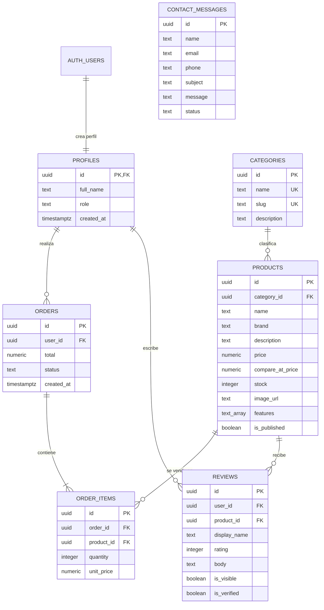

# Diagrama relacional — D'Paniagua Technology

El diagrama refleja las tablas y claves foráneas que aparecen en `database/schema.sql`.

## Relaciones y cardinalidades

- `categories (1) → (N) products`: una categoría puede tener muchos productos; cada producto pertenece a una categoría.
- `profiles (1) → (N) orders`: un cliente puede hacer muchos pedidos; cada pedido pertenece a un perfil.
- `orders (1) → (N) order_items`: un pedido contiene una o varias líneas de productos.
- `products (1) → (N) order_items`: un producto puede aparecer en muchas líneas de pedido.
- `profiles (1) → (N) reviews`: un cliente puede escribir reseñas.
- `products (1) → (N) reviews`: una reseña de producto se vincula a un producto. `product_id` admite NULL para reseñas generales.
- `auth.users (1) → (1) profiles`: el perfil se crea automáticamente mediante el trigger `handle_new_user`.
- `contact_messages` es independiente; no tiene FK en el esquema actual.

## Claves importantes

- PK: identificador único de cada fila.
- FK: referencia a otra tabla.
- UK: valor único.
- `order_items` resuelve la relación muchos-a-muchos entre `orders` y `products`.
